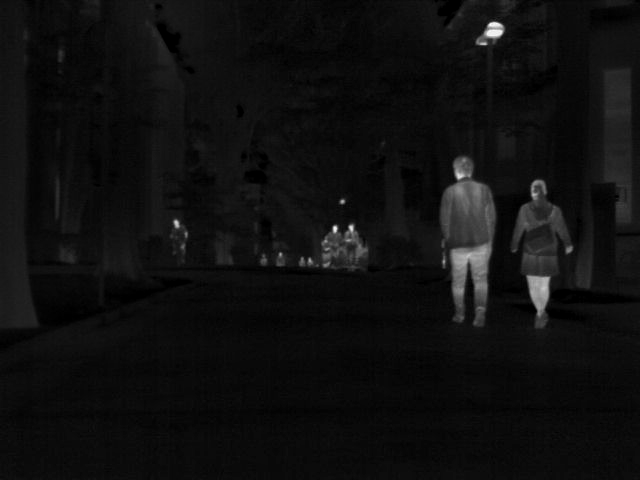
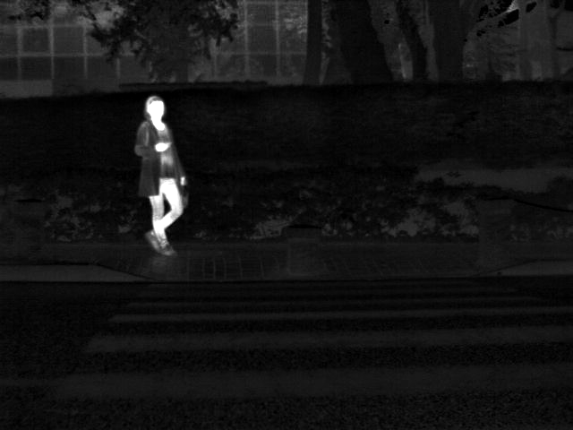

# RelationFusion

无融合真值的红外/可见光图像融合方法，模型版本 `relation_v3`。核心思想是把"融合"重新表述为"关系建模"：先显式分解两个模态之间**共有 / 私有 / 未解释**的关系，再依据证据决策加权融合；训练完全依靠自造监督信号，不使用任何融合 ground-truth。

## 融合结果展示

以下结果由仓库内的检查点 [`ckpt/latest.pt`](ckpt/latest.pt) 在 **MSRS 测试集**上推理生成。融合输出为单通道亮度图，展示时与可见光原图的色度通道合成伪彩色（`results/<run>/rgb/`）。

**MSRS · 00024N（夜间场景）**

<table>
  <tr>
    <th align="center">红外输入</th>
    <th align="center">可见光输入</th>
    <th align="center">RelationFusion 融合结果</th>
  </tr>
  <tr>
    <td align="center"></td>
    <td align="center"></td>
    <td align="center"></td>
  </tr>
</table>

**MSRS · 00123D（白天场景）**

<table>
  <tr>
    <th align="center">红外输入</th>
    <th align="center">可见光输入</th>
    <th align="center">RelationFusion 融合结果</th>
  </tr>
  <tr>
    <td align="center"></td>
    <td align="center"></td>
    <td align="center"></td>
  </tr>
</table>

夜间场景中，红外热目标（行人等）的显著性被完整保留，同时补入可见光的路灯、标线等纹理细节；白天场景中，可见光的高分辨率结构与红外目标区域互补叠加，整体亮度和色彩与源图保持一致。

推理命令（十项指标写入 `metrics.csv`，灰度结果同步保存在 `gray/`）：

```bash
python test.py --checkpoint ckpt/latest.pt --data-root data/MSRS/test \
  --output results/relation_v3 --metrics
```

## 方法概览

前向管线（`nets/fusion.py` 的 `RelationFusion`）：

1. **SharedEncoder** — Restormer 风格通道注意力 Transformer，红外/可见光共享参数、分别编码；
2. **RelationFactorization** — 关系分解：共有内容 + 各模态私有内容 + 支持度图 + 未解释残差，隶属度 sigmoid 混合；
3. **CandidateReliability / SourceTrust** — 三个候选的逐像素质量图与源图可信度；
4. **RelationDecision** — 光谱描述子 + MDA 空间注意力产生证据，Beta 证据理论决策输出融合权重与不确定度；
5. **JointInteraction** — 对未解释残差做跨通道注意力，产生联合分支；
6. **assemble + ImageDecoder** — 按质量/贡献度门控加权四条分支，解码为融合亮度图。

训练采用五阶段课程（warmup → relation → base → joint → 可选 calibration），每个参数组独立 AdamW 与绝对轮次余弦调度。监督信号由三层构成——**退化增强 + 干净参考重建**（人为制造坏区域，监督信号来自干净版本）、**自然图像弱目标**（低频最大亮度先验 + 双源一致边缘的梯度先验，双拒绝像素不罚）、**受控合成视图**（程序化合成已知共有/私有因子的图像对，为角色、干预、支持度、质量、证据、兼容性提供精确真值）——并通过系统的梯度分权设计（隶属度、质量头、组装权重的梯度来源各自隔离）保证各概念只从自己的监督信号学习。

## 环境

- Python 3.12 + PyTorch（开发环境为 torch 2.5.1 + cu124）
- 训练默认使用 CUDA；`--device cpu` 可运行但很慢；`--check-data` 无需 CUDA

## 数据准备

仓库已包含数据集目录骨架（`data/` 下各 `.gitkeep` 占位）。数据集请自行下载，图像按文件名主干与骨架目录一一对应放入：

```
data/MSRS/train/     # 训练集：1083 对
data/MSRS/test/      # 测试集：361 对
data/LLVIP/test/     # 测试集：347 对
  ir/                # 红外
  vis/               # 可见光（目录名 vis 或 vi 均可）
```

## 使用

```bash
# 数据配对冒烟检查（无需 CUDA）
python train.py --check-data

# 训练（参数在 train.py 顶部的 TRAIN_PARAMETERS / MODEL_PARAMETERS 中修改，也可用同名命令行参数覆盖）
python train.py
python train.py --output runs/relation_v3_new

# 断点续训（恢复优化器/调度器/RNG/数据加载进度）
python train.py --resume runs/relation_v3/checkpoints/latest.pt

# 推理融合 + 指标评估（EN/SD/SF/AG/MI/CC/SCD/VIF/Qabf/SSIM → metrics.csv）
python test.py --checkpoint ckpt/latest.pt --data-root data/MSRS/test \
  --output results/relation_v3 --metrics
```

## 代码结构

```
train.py / test.py   训练与推理入口（用户参数为文件顶部常量，同时生成 argparse 参数）
nets/                模型：fusion(总装) blocks(编码器/解码器) decomposition(关系分解)
                     verification(质量校验) decision(证据决策) interaction(联合交互)
                     spectral_gate / spatial_attention / beta_decision(决策子件)
utils/               dataset(配对数据) augment(退化增强) controlled_views(受控合成视图)
                     targets(目标构造) losses(损失) engine(训练引擎) settings(配置校验)
                     checkpoint(检查点) metrics(指标) operators/image/numerics/runtime
ckpt/                已训练检查点（latest.pt，可直接推理）
docs/showcase/       README 展示用图（红外/可见光/融合 三联样例）
```

## 说明

- 检查点为完整快照（模型/优化器/调度器/RNG/数据加载状态 + 训练溯源），加载时严格校验一致性；`--joint-mode auto` 依据检查点溯源自动选择推理分支。
- 训练不划分验证集、不按指标挑选检查点；参考教师（SourceTrust 冻结）通过受控视图上的程序化审计启用。
- 数据集图像、完整训练日志与批量融合结果不入库；展示样例取自 MSRS 测试集，推理脚本可一键复现全部 361 对结果。

## License

TBD
